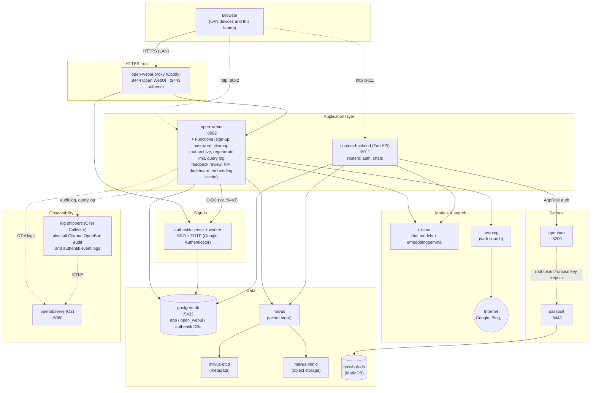

# Laptop AI Backend

A local AI stack on a personal laptop: Open WebUI as the chat frontend on local Ollama models, with web search through SearXNG and RAG on Milvus; sign-in through authentik with Google Authenticator; a custom FastAPI backend on PostgreSQL; OpenBao and Passbolt for secrets; and OpenObserve for logs and audit trails.

## Architecture



All services share the `ai-network` Docker bridge network, orchestrated via [devops/docker-compose.yml](devops/docker-compose.yml). Not drawn: the optional `lgtm` service and the one-shot setup jobs (see the table below).

## Stack

| Service | Purpose | Port |
|---|---|---|
| `postgres-db` | PostgreSQL 16 (custom-backend's database plus the `open_webui` and `authentik` databases) | 5433 → 5432 |
| `ollama` | Local LLM inference engine (chat models and the `embeddinggemma` embedding model) | (internal) |
| `open-webui` | Chat UI: Ollama models, web search, RAG on Milvus, sign-in through authentik, extended by the Functions in [devops/open-webui/functions/](devops/open-webui/functions/) | 8082 → 8080 |
| `open-webui-proxy` | Caddy HTTPS front for devices on the LAN (cert from Caddy's local CA): Open WebUI on 8444, authentik on 9443, opencode on 4443 and Attu on 3443 (both behind authentik sign-in) | 8444 → 443, 9443, 4443, 3443 |
| `authentik-server` + `authentik-worker` | SSO with TOTP (Google Authenticator) for Open WebUI and OpenBao; sign-up, invitations, password reset (see [Open WebUI SSO + MFA](docs/sso.md#open-webui-sso--mfa-authentik)) | (through `open-webui-proxy`, 9443) |
| `opencode` | Coding agent with a web UI (the admin's; everyone else gets their own `opencode-u<pk>` container from `provision.py`); stopped when idle (see [opencode](docs/opencode.md#opencode)) | 127.0.0.1:4096; LAN through `open-webui-proxy`, 4443 |
| `docling` | Text extraction with OCR for documents uploaded to Open WebUI (scanned PDFs, images, tables) | (internal, 5001) |
| `searxng` | Self-hosted metasearch engine for Open WebUI's web search | (internal, 8080) |
| `milvus` + `milvus-etcd` + `milvus-minio` | Vector store for RAG document embeddings; Open WebUI uses five shared collections (multitenancy mode), and web search rows are emptied daily by `milvus/cleanup.py` (see [docs/web-search-and-rag.md](docs/web-search-and-rag.md)) | (internal, 19530) |
| `attu` | Web UI for browsing Milvus (Attu v2.4.12, Apache-2.0; asks for Milvus's root password) | 127.0.0.1:3002; LAN through `open-webui-proxy`, 3443 (akadmin only) |
| `openbao` | Secrets storage (Postgres creds, AppRole broker) | 8200 |
| `passbolt-db` | MariaDB for Passbolt (dedicated, separate from postgres-db) | (internal) |
| `passbolt` | Password manager (stores OpenBao/AppRole tokens) | 8443 → 443 |
| `custom-backend` | FastAPI app: auth, chats, RAG document ingestion | 8011 → 8000 |
| `openobserve` | O2 observability platform: logs and audit trails (see [Logs in OpenObserve](docs/observability.md#logs-in-openobserve)) | 5080 |
| `openwebui-audit-shipper` | OpenTelemetry Collector shipping Open WebUI's audit log (who did what) and query log to O2 | (internal) |
| `ollama-log-shipper` | OpenTelemetry Collector shipping Ollama's request log (read from its Docker log file) to O2 | (internal) |
| `openbao-audit-shipper` | OpenTelemetry Collector shipping OpenBao's audit log to O2 | (internal) |
| `authentik-events-shipper` | OpenTelemetry Collector shipping authentik's audit events to O2 | 127.0.0.1:24224 (fluentd, from Docker) |
| `lgtm` | Grafana + Loki + Tempo + Mimir. **Optional**: compose profile `lgtm`, not started by default (saves ~0.8 GB RAM); start it with `docker compose -f devops/docker-compose.yml --profile lgtm up -d lgtm` | 3001 (UI), 4317/4318 (OTLP) |
| `milvus-init-auth` | One-shot job that rotates Milvus's default root password | (runs on `up`, then exits) |
| `authentik-db-init` | One-shot job that creates the `authentik` database | (runs on `up`, then exits) |
| `open-webui-fn-migrate` | One-shot job that creates the Functions' `fn_*` tables (see [Function tables](docs/open-webui-functions.md#function-tables)) | (runs on `up`, then exits) |
| `caddy-ca-export` | One-shot job that copies Caddy's public root cert for Open WebUI to trust | (runs on `up`, then exits) |

## Prerequisites

- Docker and Docker Compose
- Ollama models already pulled somewhere on the host; point `OLLAMA_MODELS_PATH` in `.env` at that directory (mounted into the `ollama` container)

## Quick start

Copy the example environment file and fill in real values (every variable is explained in [docs/configuration.md](docs/configuration.md)):

```bash
cp .env.example .env
```

Then start the stack:

```bash
docker compose -f devops/docker-compose.yml up -d postgres-db openbao   # bring up the secrets dependency first
cd openbao && ./bootstrap.sh               # one-time: unseal, write secrets, create AppRole (see openbao/README.md)
# copy the OPENBAO_ROLE_ID / OPENBAO_SECRET_ID it prints into .env
docker compose -f devops/docker-compose.yml up -d   # start everything else
```

- Open WebUI: https://`OPEN_WEBUI_HOST`:8444 from any device on the LAN, this one included; sign-in goes through authentik. Trust Caddy's root CA once per device to get rid of the certificate warning: `docker cp laptop-open-webui-proxy:/data/caddy/pki/authorities/local/root.crt caddy-root.crt`, then import it into the OS/browser trust store. http://localhost:8082 and `http://<LAN-IP>:8082` reach Open WebUI directly too, but without HTTPS, so on the LAN everything (including the sign-in token) crosses the network unencrypted; point people at 8444.
- authentik: https://`OPEN_WEBUI_HOST`:9443/if/admin/ (admin UI), `/if/user/` (a user's own password and authenticators)
- OpenObserve: http://localhost:5080 (root login from `.env`)
- Attu (Milvus): http://localhost:3002 on this laptop, or https://`OPEN_WEBUI_HOST`:3443 from the LAN (authentik sign-in as `akadmin`); connect to `milvus:19530` as `root` with `MILVUS_ROOT_PASSWORD`
- Custom backend API: http://localhost:8011
- OpenBao UI: http://localhost:8200/ui (sign in as `bao-admin`/`bao-readonly`, or through authentik with method OIDC; the root token in `openbao/keys.json` is for emergencies)
- Passbolt: https://localhost:8443 (self-signed cert; see [PASSBOLT.md](PASSBOLT.md) for one-time admin registration)
- Postgres: `localhost:5433` (credentials from `.env`)
- Grafana: http://localhost:3001, only while the optional `lgtm` service is running

Note: OpenBao starts **sealed** after every container restart or host reboot — run `cd openbao && ./auto-unseal.sh` before `custom-backend` will be able to start.

## Documentation

- [docs/configuration.md](docs/configuration.md) — every `.env` variable, image versions and upgrades
- [docs/sso.md](docs/sso.md) — authentik sign-in with TOTP: first-time setup, sign-up, invitations, password rules and reset
- [docs/open-webui-functions.md](docs/open-webui-functions.md) — signup verification, password reset and expiry, deleting users, deleted chats, the Functions' tables
- [docs/web-search-and-rag.md](docs/web-search-and-rag.md) — embeddings, web search, answer feedback, KPI dashboard
- [docs/observability.md](docs/observability.md) — logs, audit trails and email alerts in OpenObserve
- [docs/custom-backend.md](docs/custom-backend.md) — the FastAPI backend and its database migrations
- [docs/opencode.md](docs/opencode.md) — the opencode coding agent
- [docs/tests.md](docs/tests.md) — the test suite, how to run it, known gaps
- [openbao/README.md](openbao/README.md) — OpenBao setup, unsealing, logins and backups
- [PASSBOLT.md](PASSBOLT.md) — Passbolt admin registration and use
- [evals/README.md](evals/README.md) — answer-quality evals
- [ROADMAP.md](ROADMAP.md) — what this stack still lacks as an LLM engineering setup, step by step
- [DELETED_BRANCHES.md](DELETED_BRANCHES.md) — branches deleted on GitHub and how to restore one

## License

MIT. See [LICENSE](LICENSE).
